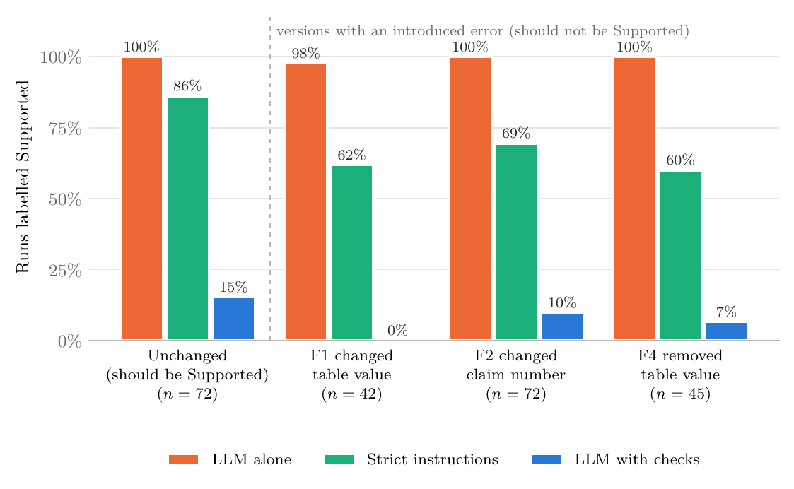

# AI for Meta-Science Hackathon: claim-evidence verification

**The LLM proposes, code proves.** This tool checks the claims in a research paper against the paper's own tables.
A language model reads the LaTeX source, finds each claim and cites its evidence by ID (a sentence `S12` or a table
cell `T2.r13.c13`). Plain code then decides: the evidence must exist, every number in the claim must appear in a cited
table cell, stated differences must recompute, and comparisons must point the right way. The label (Supported,
Unsupported or Unverified) comes from the code, never from the model, and each label lists where every number was
found. The result is a claim map for the authors, written before submission.

The tool is built on [Tygig](#tygig), an open-source TypeScript agent harness. For now the review tools are built into
the `tygig` command; later they will become a Tygig plugin.

Results on 24 claims from 9 recent arXiv papers, with planted errors (gpt-4.1-mini, 3 runs per version):

| Measure | Model alone | Strict prompt | LLM + code checks |
|---|---|---|---|
| False acceptance (planted errors labelled Supported; lower is better) | 99.4% (158/159) | 64.8% (103/159) | **6.3% (10/159)** |
| Recall (correct claims labelled Supported; higher is better) | 100.0% (72/72) | 86.1% (62/72) | 15.3% (11/72) |



**Figure 2.** Share of runs labelled Supported, by version type. On clean versions, higher is better; on versions
with a planted error, lower is better.

### Quick start

You need Node.js 22 or newer and a model provider (for example an OpenAI API key).

```powershell
git clone https://github.com/arnabfly/llm-proposes-code-proves.git
cd llm-proposes-code-proves
npm install
npm test             # optional: 165 tests, no model needed
cd packages\cli
npm link             # makes the tygig command available in any folder
tygig login          # choose a provider and model
```

Put the paper's LaTeX source in a folder, for example `my-work\paper`. Then:

```powershell
cd my-work
tygig
```

and type: `Review the paper in the folder paper.`

When the review is done, `claim-map.md` (for people) and `claim-map.json` (for programs) appear in the paper folder:
`my-work\paper\claim-map.md`.

### Rebuilding the benchmark

The benchmark program is `tygig-bench`. How to install it, run it and rebuild the benchmark from the arXiv IDs is in
[`evals/README.md`](evals/README.md). Our targets, planted versions (as a list of changes), metrics and summary are in
[`hackathon/results/`](hackathon/results/).

### Limitations

- **Numbers, not meaning.** The checks confirm that a cited cell holds the claimed number, not that it is the right
  cell for the claim. This causes most remaining false acceptances.
- **A strict rule.** A number that appears only in the text is not accepted as evidence, so many correct claims are
  Unverified and recall is low (15.3%).
- **Small scope.** One model, 9 machine learning papers, 24 claims, LaTeX only, no figures, and no errors that reverse
  a comparison.
- **Artificial errors.** The errors were planted by code and may differ from real ones. The supporting cells of the
  24 claims were checked by code, not confirmed by a person.

**Report:** [`hackathon/REPORT.md`](hackathon/REPORT.md)

**Video:** (link to be added)

**Licence:** Apache-2.0 (see `LICENSE`). Paper sources are not included: they belong to their authors and are
rebuilt from their arXiv IDs. Session logs are not included either, because they contain paper text.

---

The rest of this file is the README of Tygig, the harness this tool runs on.

# Tygig

*An agent harness where every action is permitted and proven.*

This is the **base harness**: model access, the agent loop, a terminal interface,
sign-in and saved conversations. It has no tools, plugins or skills yet, so it can
only talk. Those come next, on top of this base.

The full guide, with step-by-step traces of how the code runs, is in
`docs/tygig-base-guide.pdf` (and `.md`).

## Requirements

- Node.js 22 or newer (`node --version`)
- One of: a ChatGPT account (Go, Plus or Pro), an API key, or a local model (Ollama, LM Studio)

## Install and run

```powershell
npm install          # once, in this folder
npm test             # optional: 54 automated tests against a fake provider
npm start            # chat (logs in first if needed)
```

To use the `tygig` command in any folder:

```powershell
cd packages\cli
npm link
cd "C:\path\to\your\project"
tygig
```

## Connecting a model

`tygig login` offers three ways:

| Way | Providers |
|---|---|
| Continue with ChatGPT | your ChatGPT plan, through your browser |
| API key | OpenAI, Anthropic, OpenRouter, Google Gemini, DeepSeek, Mistral, Groq, xAI, Together AI, any OpenAI-compatible server |
| Local model | Ollama, LM Studio, any local OpenAI-compatible server |

Anthropic does not allow Claude subscription logins in other tools. For Claude models,
use an Anthropic API key or OpenRouter.

## Commands

```
tygig            chat in the current folder
tygig login      connect a provider or account
tygig logout     disconnect and remove the stored key or sign-in
tygig logout --all  remove every stored key and sign-in (switch ChatGPT account)
tygig sessions   list saved conversations for this folder
tygig help       show help
```

Inside a chat: `/model`, `/resume`, `/new`, `/login`, `/help`, `/quit`. Esc interrupts an answer.

## Where your data is stored

Everything lives in `~/.tygig` (on Windows `C:\Users\<you>\.tygig`), never in your project:

```
config.json          provider and model
credentials.json     keys and sign-in tokens
projects\<folder>\   saved conversations, one JSON Lines file each
```

## Structure

```
packages/
  core/    shared types: messages, provider shape, events
  ai/      translators: OpenAI chat, OpenAI Responses, Anthropic
  auth/    stored keys, Sign in with ChatGPT
  agent/   the loop and the session log
  ui/      terminal building blocks (Ink)
  cli/     the tygig command: screens, settings, wiring
test/      automated tests and a fake provider
```

## Licence

Apache-2.0. See `LICENSE`.
